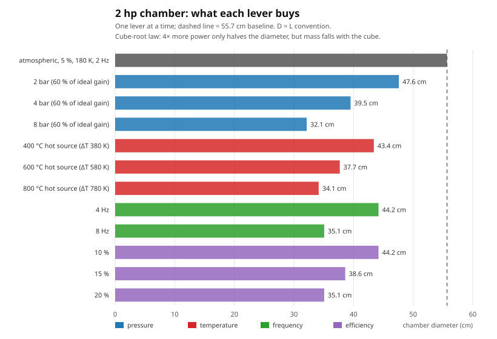
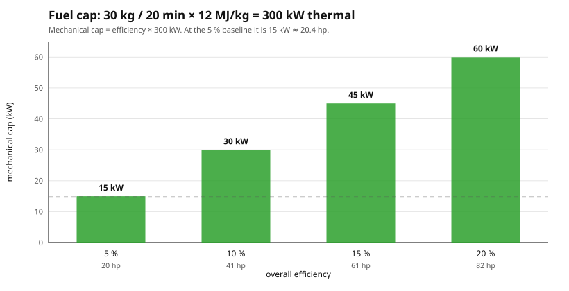

# Leviers — base pessimiste, améliorations optionnelles

> **Status:** canonical · **Owns:** leviers d'amélioration et sensibilité · **Up:** [2Cheval](../README.md) · **Lang:** FR · [EN](../../levers/README.md)

Le moteur est dimensionné à la **base pessimiste**. Chaque levier est un chemin optionnel pour rendre le même moteur plus petit, plus léger ou plus puissant. Aucun n'est nécessaire à la promesse de 2 ch.

$$P = \eta \cdot \rho \cdot f \cdot V_a \cdot C_p \cdot \Delta T \qquad V_a = \frac{V_c}{2}$$

| Paramètre | Base | Source |
|---|---:|---|
| Rendement global `η` | 5 % | [thermodynamique](../engines/manson/thermodynamics.md) |
| Écart de température `ΔT` | 180 K (200 °C / 20 °C) | [thermodynamique](../engines/manson/thermodynamics.md) |
| Fréquence `f` | 2 Hz | [dimensionnement](../engines/manson/sizing.md) |
| Masse volumique de l'air `ρ` | 1,2 kg/m³ | [glossaire](../GLOSSARY.md) |
| Capacité thermique `Cp` | 1 005 J/(kg·K) | [glossaire](../GLOSSARY.md) |
| PCI de la paille | 12 MJ/kg | [paille](../energy/rocket-stove/straw.md) |
| Limite d'alimentation | 30 kg / 20 min | [carburant](../engines/manson/fuel.md) |

À 2 ch, la base donne `V_a` = 67,8 L, `V_c` = 135,5 L, `D` = 55,7 cm (`D = L`) et environ **242 kg** d'aluminium coulé à 66 % de remplissage.

## Les six leviers

| Levier | Loi | Effet à 2 ch | Prix à payer |
|---|---|---|---|
| [Pression](pression.md) | `P ∝ ρ ∝ p` (variante fermée) | 2 bar → D 47,6 cm ; 8 bar → 32,1 cm | joints, épaisseur, masse, sécurité |
| [Température](temperature.md) | `P ∝ ΔT` à `η` constant | 400 °C → 43,4 cm ; 800 °C → 34,1 cm | matériaux, fluage, pertes |
| [Fréquence](frequence.md) | `P ∝ f` | 4 Hz → 44,2 cm ; 8 Hz → 35,1 cm | distribution, débit, usure, bruit |
| [Volume et poids](volume-poids.md) | `P ∝ V_a` ; `m ∝ V_c` | 4× la puissance = 4× la masse | manutention, matière |
| [Rendement](rendement.md) | `P ∝ η` à carburant constant | 10 % → 44,2 cm ; 20 % → 35,1 cm | combustion, étanchéité, essais |
| [Ensoleillement](ensoleillement.md) | `P_th = G · A · η_solaire` | remplace la paille, pas le moteur | surface, nuit, stockage |



**Loi de la racine cubique.** Le volume croît linéairement avec la puissance, donc le diamètre croît comme sa racine cubique : un levier de 4× ne divise `D` que par 1,59, mais la masse de fonte est divisée par 4. C'est pourquoi le même 2 ch peut être une grosse pièce coulée bon marché ou une petite chambre sous pression coûteuse.

## Le carburant est le second plafond

La puissance retenue est `min(P_air, P_fuel)`. La limite de **30 kg / 20 min** est une hypothèse à **5 %** :

<!-- calc:fuel-cap:fr -->
| Rendement | Plafond mécanique | Paille à 2 ch | Paille à 20 ch |
|---:|---:|---:|---:|
| 5 % | 15 kW ≈ 20,4 ch | 8,83 kg/h | 88,3 kg/h |
| 10 % | 30 kW ≈ 40,8 ch | 4,41 kg/h | 44,1 kg/h |
| 15 % | 45 kW ≈ 61,2 ch | 2,94 kg/h | 29,4 kg/h |
| 20 % | 60 kW ≈ 81,6 ch | 2,21 kg/h | 22,1 kg/h |
<!-- /calc:fuel-cap:fr -->



Les 20 ch extrêmes sont exactement à 30 kg / 20 min **seulement à 5 %**. À 15 %, la même alimentation laisse 45 kW, mais la chambre et les matériaux doivent suivre. Voir [carburant](../engines/manson/fuel.md).

## Pourquoi c'est une histoire de résilience

Si un levier échoue, un autre prend le relais : rendement faible → chambre plus grande ; masse excessive → pression ou fréquence ; paille chère → rendement ou solaire ; pas de soleil → paille ; pas de biomasse → [solaire](../energy/solaire/README.md) ou [nucléaire](../energy/nuclear/README.md). La base pessimiste n'est pas un défaut à excuser : c'est le plancher garanti. Voir [résilience](../business/resilience.md).

## Dessins et tableaux soft-coded

Les paramètres sont dans [`model/params.json`](../../model/params.json) ; les calculs sont réunis dans [`tools/calc.py`](../../tools/calc.py). Les tableaux marqués (`<!-- calc:... -->`) et les SVG ci-dessous sont régénérés depuis la même source :

```bash
python3 tools/calc.py --update   # réécrit les tableaux dérivés dans les docs
python3 tools/calc.py            # régénère les SVG
python3 model/levers.py --check  # contrôle de compatibilité
```

Voir [modèle](../modele/README.md) et [CAO paramétrique](../engines/manson/scad/README.md).

## Voir aussi

- [Pression](pression.md) · [Température](temperature.md) · [Fréquence](frequence.md) · [Volume et poids](volume-poids.md) · [Rendement](rendement.md) · [Ensoleillement](ensoleillement.md)
- [Dimensionnement](../engines/manson/sizing.md) · [Thermodynamique](../engines/manson/thermodynamics.md) · [Carburant](../engines/manson/fuel.md)
- [Version anglaise (dérivations)](../../levers/README.md)
