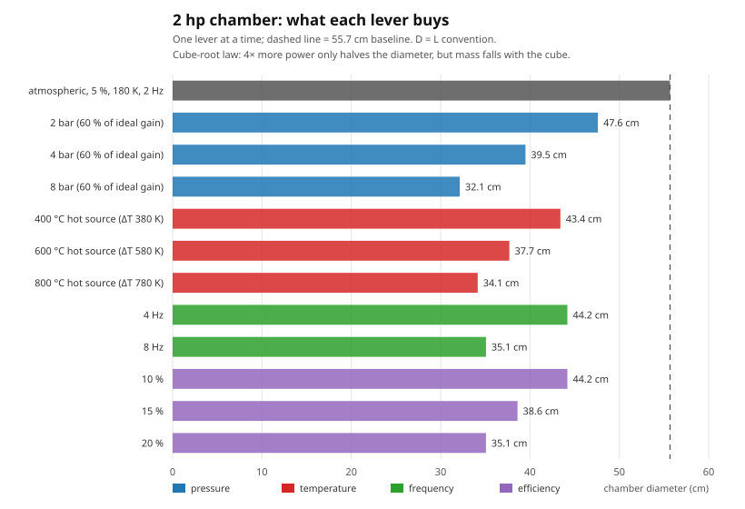
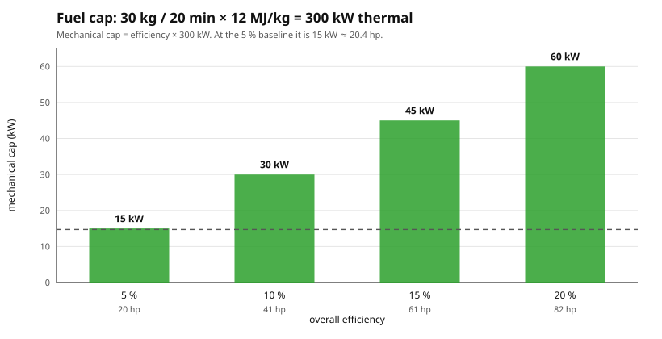

# Levers — pessimistic baseline, optional upside

> **Status:** canonical · **Owns:** improvement levers and sensitivity · **Up:** [2Cheval](../README.md) · **Lang:** EN · [FR](../2cheval/leviers/README.md)

The engine is sized at the **pessimistic baseline**. Every lever below is an optional way to make the same engine smaller, lighter or more powerful. None is required for the 2 hp promise.

$$P = \eta \cdot \rho \cdot f \cdot V_a \cdot C_p \cdot \Delta T \qquad V_a = \frac{V_c}{2}$$

| Parameter | Baseline | Source |
|---|---:|---|
| Overall efficiency `η` | 5 % | [thermodynamics](../engines/manson/thermodynamics.md) |
| Temperature difference `ΔT` | 180 K (200 °C hot, 20 °C ambient) | [thermodynamics](../engines/manson/thermodynamics.md) |
| Cycle frequency `f` | 2 Hz | [sizing](../engines/manson/sizing.md) |
| Air density `ρ` | 1.2 kg/m³ | [glossary](../GLOSSARY.md) |
| Air heat capacity `Cp` | 1 005 J/(kg·K) | [glossary](../GLOSSARY.md) |
| Straw LHV | 12 MJ/kg | [straw](../energy/rocket-stove/straw.md) |
| Feed limit | 30 kg / 20 min | [fuel](../engines/manson/fuel.md) |

At 2 hp the baseline gives `V_a` = 67.8 L, `V_c` = 135.5 L, `D` = 55.7 cm (`D = L`) and a cast chamber mass of about **242 kg** at 66 % fill.

## The six levers

| Lever | Law | 2 hp effect | Price to pay |
|---|---|---|---|
| [Pressure](pressure.md) | `P ∝ ρ ∝ p` in a sealed variant | 2 bar → D 47.6 cm; 8 bar → 32.1 cm (60 % of ideal gain) | seals, wall thickness, mass, safety |
| [Temperature](temperature.md) | `P ∝ ΔT` at constant `η` | 400 °C → 43.4 cm; 800 °C → 34.1 cm | materials, creep, losses, insulation |
| [Frequency](frequency.md) | `P ∝ f` | 4 Hz → 44.2 cm; 8 Hz → 35.1 cm | port timing, flow, wear, noise |
| [Volume and weight](volume-weight.md) | `P ∝ V_a`; `m ∝ V_c` | 4× power = 4× chamber mass at constant technology | weight, material, handling |
| [Efficiency](efficiency.md) | `P ∝ η` at constant fuel | 10 % → 44.2 cm; 20 % → 35.1 cm | combustion, sealing, iteration |
| [Insolation](insolation.md) | `P_th = G · A · η_solar` | replaces the straw feed, not the engine | collector area, night, storage |



**Cube-root law.** Volume grows linearly with power, so diameter grows as the cube root: a 4× lever only halves `D`, but chamber mass falls with the cube. That is why the same 2 hp can be a large cheap casting or a compact expensive pressure vessel.

## Fuel is the second cap

The retained power is `min(P_air, P_fuel)`. The 30 kg / 20 min feed is a **5 % baseline** statement:

<!-- calc:fuel-cap:en -->
| Efficiency | Mechanical cap | 2 ch straw (kg/h) | 20 ch straw (kg/h) |
|---:|---:|---:|---:|
| 5 % | 15 kW ≈ 20.4 ch | 8.83 kg/h | 88.3 kg/h |
| 10 % | 30 kW ≈ 40.8 ch | 4.41 kg/h | 44.1 kg/h |
| 15 % | 45 kW ≈ 61.2 ch | 2.94 kg/h | 29.4 kg/h |
| 20 % | 60 kW ≈ 81.6 ch | 2.21 kg/h | 22.1 kg/h |
<!-- /calc:fuel-cap:en -->



The 20 hp extreme sits exactly at 30 kg / 20 min **only at 5 %**. At 15 % it uses about 9.8 kg / 20 min, but the chamber volume and materials must still support the power. See [fuel](../engines/manson/fuel.md).

## Why this is a resilience story

If one lever fails, another can take over: low efficiency → larger volume; excessive weight → higher pressure or frequency; expensive fuel → higher efficiency or solar; no sun → straw; no biomass → [solar](../energy/solar/README.md) or the [nuclear variant](../energy/nuclear/README.md). The pessimistic baseline is not a limit to apologise for; it is the guaranteed floor. See [resilience](../business/resilience.md).

## Soft-coded drawings and tables

Parameters live in [`model/params.json`](../model/params.json); calculations are consolidated in [`tools/calc.py`](../tools/calc.py). Marked tables (`<!-- calc:... -->`) and the SVGs below are regenerated from the same source:

```bash
python3 tools/calc.py --update   # rewrite derived tables in docs
python3 tools/calc.py            # regenerate SVGs
python3 model/levers.py --check  # compatibility check
```

The CAD sketch is also parametric: see [piston.scad](../engines/manson/scad/piston.scad) and [model](../model/README.md).

## See also

- [Pressure](pressure.md) · [Temperature](temperature.md) · [Frequency](frequency.md) · [Volume and weight](volume-weight.md) · [Efficiency](efficiency.md) · [Insolation](insolation.md)
- [Sizing](../engines/manson/sizing.md) · [Thermodynamics](../engines/manson/thermodynamics.md) · [Fuel](../engines/manson/fuel.md)
- [French lever sheets](../2cheval/leviers/README.md)
