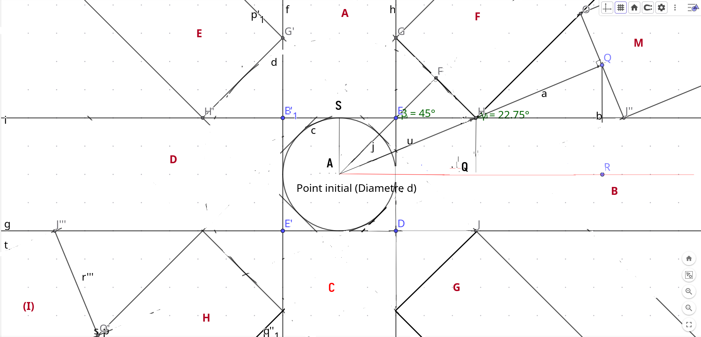

# Polar Grid / Grille polaire

> **Status:** canonical geometry · **Up:** [Polar slicer](README.md)

**FR** — Géométrie de base du slicer polaire : les rayons sont espacés angulairement et doivent être décalés près du centre pour éviter le chevauchement.  
**EN** — Base geometry of the polar slicer: rays are spaced angularly and must be offset near the centre to avoid overlap.

## Polar lines / Lignes polaires

### Limit / Limite

First Draw lines are A B C and D. The second (and so on) lines must be cleared to avoid overlaying. E F G H lines must be offset by a distance `l = AF`, depending on an angle `Beta = pi / 4`.

Les premières lignes sont A B C et D. Les suivantes doivent être décalées pour éviter le recouvrement. Les lignes E F G H doivent être décalées d'une distance `l = AF`, selon un angle `Beta = pi / 4`.

(I) (J) (K) (L) M (N) (O) and (P) are not represented (but M) and should have an offset of `l = AQ`.

(I) (J) (K) (L) M (N) (O) et (P) ne sont pas représentés (sauf M) et doivent avoir un décalage `l = AQ`.

[Here is the angular-limit derivation](angular-limit.md).  
[Voici la dérivation de la limite angulaire](angular-limit.md).

## See also / Voir aussi

- [Angular limit / Limite angulaire](angular-limit.md)
- [Prototype / Prototype](prototype.md)
- [Polar slicer hub / Hub](README.md)
